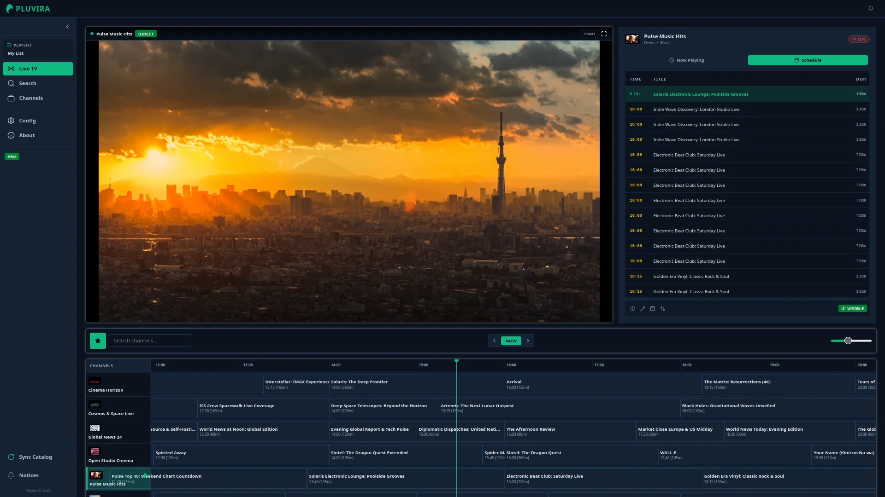
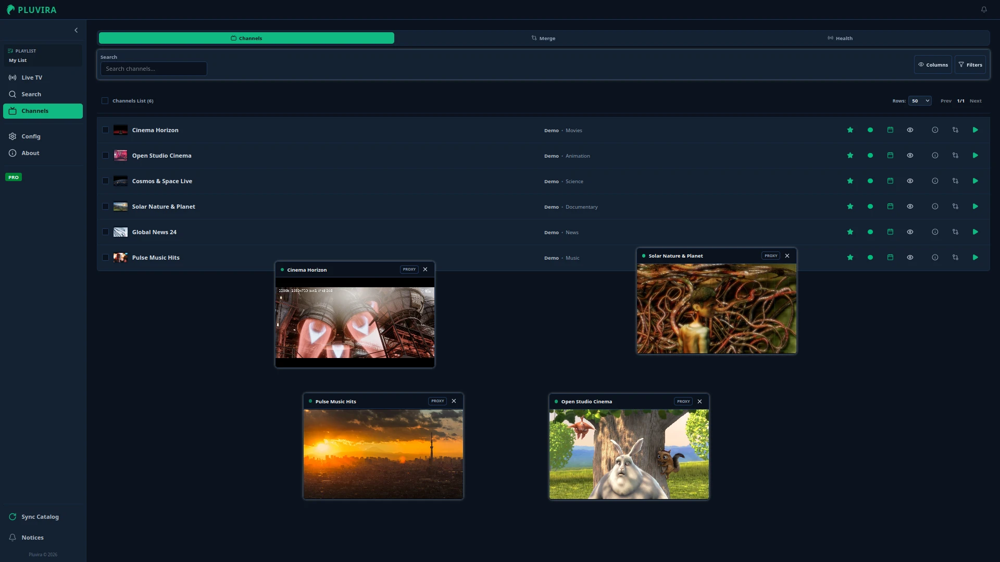
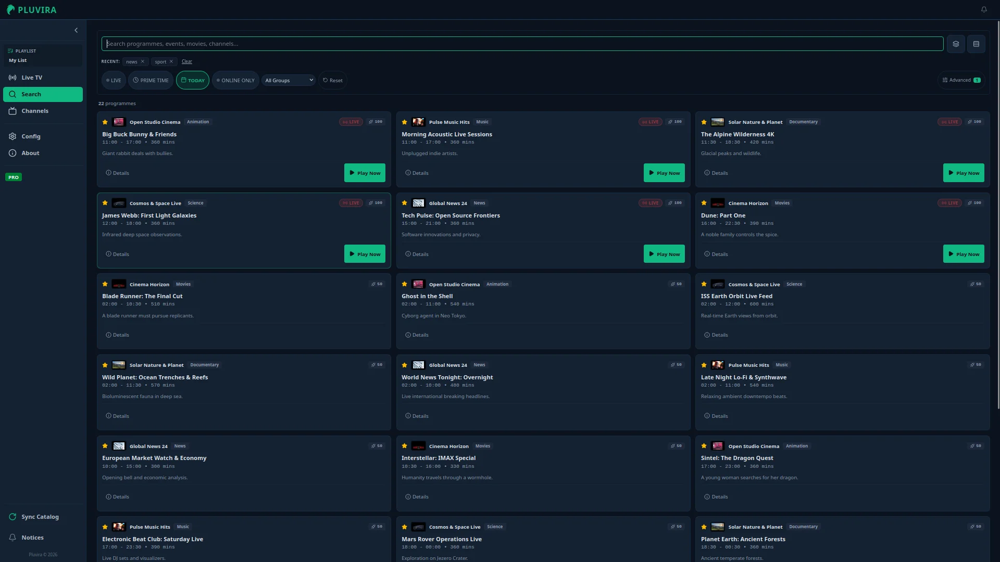
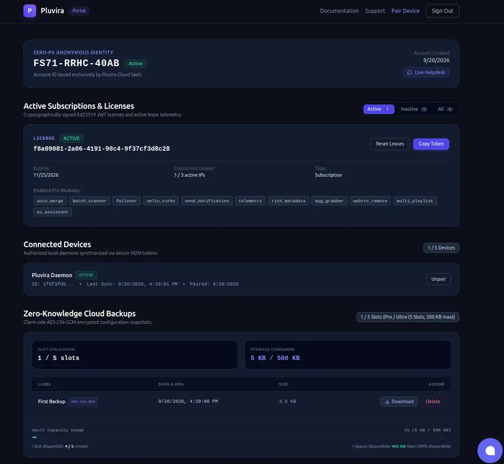

<!-- markdownlint-disable MD033 -->
<!-- markdownlint-disable MD041 -->
<p align="center">
  
</p>
<!-- markdownlint-enable MD033 -->
<!-- markdownlint-enable MD041 -->

# Pluvira

[](https://github.com/pluvira/pluvira)
[](https://mariadb.com/bsl11/)
[](https://www.python.org)

**Pluvira** is a high-performance, self-hosted media aggregator, programme schedule (EPG) manager, and stream failover engine built for home servers, NAS hardware (Synology, TrueNAS, Unraid), and local edge environments.



---

### The Problem vs The Solution

* **The Problem**: Self-hosted media enthusiasts often manage multiple playlist feeds resulting in **40,000+ noisy, duplicate channels**, missing or desynchronized EPG guides, fragile stream links, and heavy database micro-writes that degrade NAS SSD/SMR storage.
* **The Solution**: Pluvira aggregates, deduplicates, cleans, and transforms raw feeds on-the-fly into a **clean, curated lineup** with synchronized XMLTV schedules, instant multi-stream failover, and zero-wear volatile RAM disk (`tmpfs`) processing.

---

## Legal & Compliance Notice

> **IMPORTANT DISCLAIMER**: Pluvira is strictly a **neutral software tool and local media aggregator**.
>
> 1. **No Bundled Content**: Pluvira does not host, provide, broadcast, distribute, sell, or index any video streams, playlist files, or copyrighted media.
> 2. **User Responsibility**: Users are solely responsible for supplying their own legally acquired M3U playlists and XMLTV guides.
> 3. **Non-Affiliation**: Pluvira is completely independent and has no affiliation with any third-party IPTV service providers or content networks.
> 4. **Compliance**: It is the end-user's sole legal responsibility to ensure their use of this software complies with all applicable copyright, broadcasting, and intellectual property laws in their jurisdiction.

---

## Core vs Pro Architecture & Cloud Boundaries

* **Core Edition (Self-Hosted / Source-Available)**: The complete Core stack in this repository runs **100% offline with zero cloud dependencies and zero outbound network telemetry by default**.
* **Optional Cloud Pairing (Opt-In)**: Linking an instance to `pluvira.com` via RFC 8628 is completely voluntary and required only for zero-knowledge E2EE backup snapshot vaults, customer portal recovery, and automated license renewal.
* **Decoupled Pro Engine**: High-throughput multithreaded native Rust optimization binaries are proprietary components executed via asynchronous Subprocess IPC (`ProBridge`). The binary is not included in this repository; when absent, Core automatically falls back to native Python engines.

| Feature | Core Edition (Free Tier / BSL 1.1) | Pro Edition (Proprietary Engine) |
| :--- | :--- | :--- |
| **Data Pipeline & RAM Disk (`tmpfs`)** | Included | Included |
| **Svelte 5 WebUI & Multi-Theme System** | Included | Included |
| **Cascading Rewrite Engine & Overrides** | Python Sequential $O(N \times R)$ | Native Turbo Rewrite (Rayon Multi-Core, <500ms) |
| **On-Demand Single Link Verification** | Included | Included |
| **M3U & XMLTV Dynamic Exports** | Included | Included |
| **Channel Merging & Deduplication** | Python Exact & Fuzzy Match ($\ge 85\%$) | Multithreaded Rust Auto-Merge (Rayon, $50\%-100\%$) |
| **Batch Stream Link Testing** | Polite Sequential Python Scanner | Async Tokio/Reqwest Batch Scanner |
| **EPG Guide Ingestion** | Streaming XMLTV Parser (`pluvira_epg.db`) | Native Turbo Parser (`quick-xml` + `flate2`) |
| **Stream Failover Promotion** | Manual / Python Health Ranking | Native Failover Engine (`evaluate-failover`) |
| **System Notifications** | Local Logs & In-App UI Toasts | Event Matrix Webhooks (Telegram, Discord, Slack) |
| **Remote WebUI Access** | Local LAN / Reverse Proxy | Local LAN / Reverse Proxy (Remote Tunnel in Roadmap) |
| **Zero-Knowledge E2EE Cloud Backup** | 1 Manual Snapshot (200 KB, Paired Only) | 5 Automated Rotating Snapshots (500 KB, Pro) |
| **Stream Health Telemetry** | Disabled / Local Only | Privacy-Preserving $k \ge 50$ k-Anonymity (Opt-In) |
| **Rich EPG Metadata Enrichment** | On-Demand Resolvers (TMDb, TVMaze, Wiki) | Background Pre-fetcher & Sub-5ms Search |
| **System Bulletins Broadcast** | Heartbeat Ingestion (Paired Only) | Heartbeat Ingestion (Paired Only) |

---

## Outbound Network Transparency & Privacy Controls

Pluvira is engineered around strict local data sovereignty. All outbound network traffic categories are documented below:

1. **User-Configured Feeds**: Outbound HTTP/HTTPS requests to download external M3U playlists and XMLTV guides occur exclusively for URLs explicitly configured by the user.
2. **Third-Party Metadata Resolvers (TMDb, TVMaze, Wikipedia)**: When Rich EPG metadata enrichment is active, the local daemon queries public APIs (The Movie Database, TVMaze, Wikipedia REST) to fetch posters, ratings, and synopses. These queries originate directly from your server's IP address. You can selectively toggle or completely disable external lookups in Settings (`General ➔ Advanced ➔ Metadata Providers`).
3. **Optional Cloud Pairing & E2EE Vault (Opt-In)**: Contact with `pluvira.com` occurs **only** if you voluntarily pair your instance via RFC 8628 or activate a Pro license token. Unpaired instances generate zero outbound network traffic to Pluvira Cloud.
4. **Telemetry ($k \ge 50$)**: Privacy-preserving stream reliability metrics are strictly opt-in and active only on paired instances, scrubbing all query parameters and enforcing $k \ge 50$ k-anonymity aggregation thresholds.

---

## Screenshots & Interface Tour

### 🎛️ Real-Time Multi-View Stream Engine


Monitor and stream multiple live channels simultaneously with decoupled floating players, dynamic health scores, and automated failover:



### 🔍 Intelligent Content Discovery & EPG Search

High-speed full-catalog search with relevance scoring, NLP tokenization, and live broadcast filter pills:



### 🛡️ Privacy-First Customer Portal & Cloud Vault

Zero-PII Crockford Base32 identity, RFC 8628 device pairing, active lease management, and client-side AES-256-GCM encrypted backup vault:



---

## Key Features

* **Persistent Appliance Identity & Idempotent Pairing: Implements volume-bound appliance identity (`data/.instance_id`) with CSPRNG 32-byte hexadecimal tokens and `HMAC-SHA256` hash derivation, eliminating host `/etc/machine-id` or `/sys` inspection, ensuring zero identity drift across container updates, and powering idempotent re-pairing that automatically reconciles appliance quota on Pluvira Cloud.
* **Live TV Mode: Embedded 16:9 responsive live stream player with height-matched programme schedule info, live progress metadata, expandable channel/content/group/source filter ribbon, and synchronized real-time EPG timeline grid (`#/live`).
* **Rich EPG Metadata Enrichment Engine**: Cleans noisy IPTV broadcast titles, extracts episodic tags and release years, resolves synopsis, community ratings, cast chips, and high-resolution posters/backdrops across cascading providers (TMDb, TVMaze, Wikipedia REST), with RAM disk volatile artwork proxying (`/dev/shm/pluvira/artwork_cache`) and SQLite WAL metadata caching (`pluvira_metadata.db`).
* **Piggybacked System Bulletins**: Resilient 1-to-many broadcast channel for maintenance notices and version updates piggybacked onto license heartbeats with `bulletin_hash` bandwidth optimization, zero-PII multilingual dictionaries (`Record<string, string>`), local SQLite WAL persistence with multi-session dismissal synchronization, emergency top alert ribbon for security advisories, and an unread notice drawer.

* **Decoupled Data Flow**: Separates raw data acquisition (`UpdateRunner`) from on-the-fly business logic transformations (`DataProcessor`) to minimize bandwidth and disk wear, with DRY service delegation.
* **SMR & ZFS Storage Optimization**: Mitigates write amplification on NAS disks by routing temporary processing through a volatile RAM disk (`/dev/shm/pluvira`) and persisting database files atomically via SQLite WAL mode.
* **Decoupled Svelte 5 WebUI**: Modern reactive Single Page Application with dynamic theme switching, mobile-first bottom sheets, Lucide iconography, and accessibility primitives.
* **Cascading Rewrite Engine & Turbo Acceleration**: Applies metadata transformations sequentially across three levels (Global ➔ Source-specific ➔ Individual channel rules) with impact tracking (`rewrite_details`). In Pro Edition, the native Turbo Cascade Rewrite Engine delegates execution via Zero-Copy SQLite WAL IPC to parallel Rayon worker threads, transforming 100,000+ channels in sub-second time with `is_modified` state tracking, native capability introspection (`supported_commands`, `supported_modules`), and strict `cascade_rewrite` license module gating.
* **Decoupled EPG Sources & Tiered Auto-Assign**: Manages XMLTV guides independently from M3U playlists, featuring positional priority matching, namespaced EPG IDs, and intelligent tiered auto-mapping (`POST /api/v1/channels/auto-map-epg`) supporting 1-click Free Tier matching for "My List" (max 25 channels, $\ge 85\%$ confidence) and Pro catalog-wide deep fuzzy matching.
* **Intelligent EPG Search & Visual Highlighting**: Dual-box search engine featuring relevance scoring, multi-language stop-words tokenization, diacritic normalization, whole-word boundary matching (`\b`), time-aware boosting, Methodologies A/B/C/D toggles, and visual gold/dimmed programme block highlighting.
* **Bulk Source Management**: Comprehensive REST API support for bulk enabling, disabling, deleting, reordering, User-Agent updating, and selective background refreshing of multiple M3U and EPG sources.
* **Robust M3U & XMLTV Parsers**: Streaming parsers supporting unified `#EXTINF` metadata line extraction (`parse_extinf_metadata`), UTF-8-SIG BOM stripping, encoding fallback, and flexible ISO timezone parsing (`+02:00`/`+0200`).
* **Protected System Tasks & Background Scheduler**: Modular domain-driven scheduler with protected system task governance, safe heartbeat intervals, auto-preservation against accidental deletion, disabling safety alerts, and 1-click factory defaults restoration (`POST /api/v1/scheduler/restore-defaults`).
* **Polite Link Scanner & Failover**: Performs deep link testing with redirect tracing and custom User-Agents, automatically promoting backup streams on failover.
* **Live Video Player & CORS Proxy**: Floating multi-window video player supporting dual-engine HLS (`hls.js`) and MPEG-DASH (`dashjs`) streaming, 3-retry automatic recovery with backoff, automated backup stream failover, format resolution, and CORS proxy relay (`GET /api/v1/stream/proxy`).
* **Channel Merge & Failover**: Performance-optimized deduplication engine with fast prefix/token pre-filtering (`_quick_prefix_match`), `mtime`-cached cluster evaluation in `MergeService`, candidate stream disambiguation (`candidate_id`), native backend cluster status enrichment (`is_merged`, `status`, `merged_details`), atomic bulk merge apply/delete, high-confidence auto-merge powered by `find-duplicate-clusters`, and aggregate stats tracking.
* **Consolidated 2-DB SQLite Architecture & BaseRepository**: Streamlined 2-database relational architecture in WAL mode (`pluvira_main.db` for core settings, curated playlists, and execution history; `pluvira_epg.db` for raw catalog, EPG guides, and stream link health) with generic `BaseRepository` connection and schema lifecycle management, zero-write RAM performance via Linux Kernel Page Cache, and transactional concurrency safety.
* **Zero-Knowledge E2EE Cloud Backup Vault**: Client-side encrypted configuration backups using AES-256-GCM and PBKDF2 (600,000 iterations). Encryption keys and passphrases never leave the client browser or local environment; the cloud stores only opaque ciphertext.
* **Curated Personal Playlists & Health Ranking**: User-owned stable `PersonalChannel` entities with up to 7-slot stream pools ranked by dynamic Health Score (0-100), 3-retry failover auto-switching, 4-tier confidence auto-attach pipeline, suggestions queue, quarantine isolation, and manual/scheduled auto-purge.
* **Event-Driven Notifications**: Professional event-driven notification engine featuring centralized factory initialization, single-source-of-truth event defaults, 27+ event triggers, additive presets, and hardware/system load alerts.
* **Hardware & System Health**: Real-time monitoring of RAM disk capacity (`/dev/shm`), CPU load, and system temperature with critical alerts (`SystemHealth`).
* **REST API & CLI**: Exposes FastAPI endpoints for integration, JSON body search/filter payloads for enhanced privacy, dynamic M3U/XMLTV exports, and a Typer-based CLI for standalone execution.
* **Svelte SPA Direct Mount & JWT Auth**: Automated multi-stage Docker build pipeline (`node:22-slim` + `python:3.12-slim`), direct static asset mounting for Svelte SPA (`frontend/dist`) leveraging Linux Kernel Page Cache, configurable JWT Bearer token authentication (`/api/v1/auth/login`), and decoupled router security dependencies.
* **Strict Static Typing**: 100% Python type hints coverage across all core engines and service layers, utilizing concrete Pydantic models for robust validation and IDE support.
* **Centralized Domain Exceptions & Service DI**: Semantic domain exception hierarchy (`EntityNotFoundError`, `DuplicateEntityError`, `InvalidConfigurationError`, `ProcessLockedError`) handled globally via FastAPI exception handlers, decoupled DTOs in `models.py`, and FastAPI `Depends()` service injection, eliminating endpoint boilerplate and enforcing strict Separation of Concerns (SoC).

---

## Directory Structure

```text
pluvira/
├── backend/                    # Decoupled Headless Backend
│   ├── api/                    # Security dependencies (deps.py) and v1 router
│   │   └── v1/endpoints/       # REST API v1 endpoints (channels, sources, epg, merge, etc.)
│   ├── config/                 # Pydantic configuration models and YAML handlers
│   ├── core/                   # Core engines (runner, processor, pro_bridge, scanner, etc.)
│   ├── services/               # Service Layer (ChannelService, SourceService, MergeService)
│   ├── scheduler/              # Background job scheduler (APScheduler)
│   ├── utils/                  # Thread-safe logging queue and helpers
│   ├── main.py                 # FastAPI application entrypoint
│   └── cli.py                  # Typer CLI application entrypoint
├── config/                     # Configuration files (config.yaml, schedule.yaml)
├── data/                       # Persistent SQLite WAL databases and exports
├── docs/                       # Documentation (Architecture, Config, Notifications, API, Testing)
├── frontend/                   # Svelte 5 SPA Frontend (Vite + Tailwind CSS v4)
├── docker-compose.yml          # Production Docker deployment
├── Dockerfile                  # Multi-stage Docker build
└── requirements.txt            # Python dependencies
```

---

## Quick Start

### 1. Docker Run (Instant Prebuilt Image)

```bash
docker run -d \
  --name pluvira \
  -p 8585:8585 \
  --tmpfs /dev/shm:rw,size=512m \
  -v $(pwd)/config:/app/config \
  -v $(pwd)/data:/app/data \
  ghcr.io/pluvira/app:latest
```

### 2. Docker Compose (Recommended for NAS & Servers)

Docker Compose automatically configures the RAM disk (`tmpfs`) to protect your persistent storage, binds port `8585`, and aligns volume permissions with your host user (`${UID:-1000}:${GID:-1000}`).

```bash
# Clone the repository
git clone https://github.com/pluvira/pluvira.git
cd pluvira

# Start the container in production mode (compiling multi-stage assets)
docker compose up --build -d
```

The WebUI will be accessible at `http://localhost:8585`.

#### Production Verification & Health Check

```bash
# Verify container status
docker compose ps

# Verify backend API health endpoint (returns dynamic version and git_hash)
curl -s http://localhost:8585/api/v1/health

# Verify static SPA asset serving
curl -s http://localhost:8585/ | grep -i "Pluvira"
```

### 3. Running from Git Clone (Development)

#### Backend (FastAPI Daemon)

```bash
# Create and activate virtual environment
python3 -m venv .venv
source .venv/bin/activate

# Install dependencies
pip install -r requirements.txt

# Start FastAPI backend server
uvicorn backend.main:app --host 0.0.0.0 --port 8585 --reload
```


#### Frontend (Svelte 5 + Vite WebUI)

```bash
# Navigate to frontend directory
cd frontend

# Install Node.js dependencies
npm install

# Start Vite development server
npm run dev

# Run strict TypeScript and Svelte diagnostics
npm run check

# Build production static bundle (outputs to frontend/dist)
npm run build
```

### 4. Standalone CLI Installation

If you prefer to run the application directly on your host system:

```bash
# Create and activate a virtual environment
python3 -m venv .venv
source .venv/bin/activate

# Install dependencies
pip install -r requirements.txt

# Run the standalone update process
python -m backend.cli run --standalone
```

---

## Configuration

The application is configured via two main files located in the `config/` directory:

* `config.yaml`: Defines global settings, IPTV sources, global EPG guide sources, and rewrite rules.
* `schedule.yaml`: Configures background update tasks, cron/interval triggers, and system license auto-renewal.

For detailed configuration options, see [docs/configuration.md](docs/configuration.md).

---

## Documentation Index

To explore specific aspects of the project, refer to the following documents:

* **[Architecture Guide](docs/architecture.md)**: Deep dive into the MVVM pattern, data flow, and ZFS/SMR hardware optimizations.
* **[Merge & Failover Guide](docs/merge.md)**: Detailed guide on channel deduplication, backup stream chains, and automatic failover.
* **[Configuration Guide](docs/configuration.md)**: Detailed instructions on YAML settings, cascading rewrites, and scheduler setup.
* **[REST API v1 Reference](docs/api_v1_reference.md)**: Complete REST API v1 specifications, endpoints, query parameters, and JSON payloads for frontend teams (Svelte, Android TV, Mobile, Desktop).
* **[Notifications Guide](docs/notifications.md)**: Detailed guide on the event-driven notification system and presets.

---

## Licensing & Business Source License 1.1 (BSL)

`pluvira` Core is source-available software licensed under the **Business Source License 1.1 (BSL 1.1)**.

### Additional Use Grant (AUG) — Personal & Homelab Free Tier

Pursuant to the **Additional Use Grant** defined in [LICENSE.md](LICENSE.md), you are granted free, non-exclusive permission to use, modify, and self-host Pluvira for personal, educational, and homelab purposes.

The Personal Free Tier programmatically enforces the following functional resource thresholds:
1. **Maximum 2 Active M3U Playlists** configured simultaneously.
2. **Maximum 1 Curated Personal Playlist** ("My List", slug `default`).
3. **Maximum 2,500 Total Ingest Channels** stored and indexed in local SQLite WAL databases.
4. **Maximum 25 Curated Channels** active in "My List" (channels beyond index 25 are non-destructively preserved in local state and omitted from exports).
5. **Maximum 2 Failover Stream Slots** per channel (Slot 0 Primary + Slot 1 Backup).
6. **Maximum 2 Concurrent Stream Views** (unique local client IP address leases).

### Change License Conversion

Under the terms of the BSL 1.1, each version of Pluvira automatically converts to the open-source **Apache License 2.0** exactly **48 months (4 years)** after its initial release date.

### Commercial / Pro Tier

Use of the software in a commercial production environment or beyond the Personal Free Tier Additional Use Grant requires a valid **Commercial License**.

For commercial licensing and inquiries: `sales@pluvira.com`
